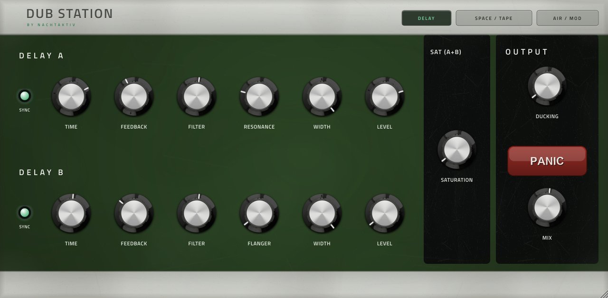

# Dub Station (VST3 / AU)

**Your one-stop effect plugin for dub techno**, jetzt als VST3 und AU für Mac und als VST3 für Windows.

Das ist die Desktop-Version von [mpc-vst-dub-station](https://github.com/nachtaktiv303/mpc-vst-dub-station).
Der Klang ist derselbe: Die Desktop-Version nutzt dieselbe DSP wie die MPC-Version. Neu ist nur die Hülle für
die DAW. Das MPC-Projekt bleibt davon unberührt.



## Installieren

Die fertigen Dateien liegen unter [Releases](../../releases/latest).

**Mac** (Apple Silicon und Intel, ab macOS 11)
1. `DubStation-…-macOS.pkg` herunterladen und doppelklicken.
2. macOS meldet beim ersten Mal, dass es die Datei nicht öffnen kann, weil das Plugin nicht bei Apple
   signiert ist. Dann *Systemeinstellungen → Datenschutz & Sicherheit* öffnen, nach unten scrollen und bei
   „DubStation…pkg“ auf **Trotzdem öffnen** klicken.
3. Der Installer legt VST3 und AU in `/Library/Audio/Plug-Ins/`. Danach in der DAW nach neuen Plugins suchen
   lassen.

**Windows**
1. `DubStation-…-Windows-VST3.zip` entpacken.
2. Den Ordner `Dub Station.vst3` nach `C:\Program Files\Common Files\VST3` kopieren.

## Was anders ist als auf der MPC

- **Alle Sampleraten:** Der Effekt rechnet intern immer mit 44,1 kHz, so wie auf der MPC. Läuft die DAW mit
  48 oder 96 kHz, wird automatisch umgerechnet. Das kostet etwa 1 ms Verzögerung, die der DAW gemeldet und von
  ihr ausgeglichen wird. Bei 44,1 kHz gibt es keine Verzögerung.
- **Sync** folgt dem Tempo der DAW.
- **Kein Clipping:** Der Ausgang wird nicht auf 16 Bit begrenzt.
- **Fenstergrösse:** Das Fenster lässt sich an der Ecke unten rechts grösser und kleiner ziehen.
- **Bedienung:** Doppelklick auf einen Regler setzt ihn auf den Standardwert zurück. Beim Darüberfahren zeigt
  das Label den aktuellen Wert.

## Selber bauen

Braucht CMake (ab 3.22) und einen C++-Compiler (Xcode auf dem Mac, Visual Studio auf Windows). JUCE wird
automatisch heruntergeladen.

```sh
cmake -B build -DCMAKE_BUILD_TYPE=Release
cmake --build build --config Release
```

Bei jedem Push baut GitHub Actions automatisch Mac und Windows. Ein Tag wie `v1.0.1` erstellt daraus ein Release.

## Aufbau

| Ordner | Inhalt |
|---|---|
| `dsp/` | Kopie der DSP aus dem MPC-Repo (`src/`). Einzige Änderung: `dub_engine_process_float` am Ende von `engine.cpp`. |
| `source/` | Die Plugin-Hülle (JUCE): Parameter, Umrechnung der Samplerate, Oberfläche. |
| `assets/` | Knopf-Filmstrip, Panic-Button, Texturen und Schrift aus dem MPC-Skin. |
| `tests/` | Offline-Tests: Latenz und Genauigkeit bei 44,1/48/96 kHz, Echo-Timing, Stresstest. |

Klangänderungen an der MPC-Version werden nicht automatisch übernommen. Um sie zu übernehmen, `src/` aus dem
MPC-Repo nach `dsp/` kopieren und die Funktion am Ende von `engine.cpp` wieder anhängen.

## Credits & Lizenzen

MIT, wie die MPC-Version. Die DSP verwendet Airwindows Galactic (MIT, © Chris Johnson), CHOMPI TAPE 2.0
(MIT, © CHOMPI Club / Chase Bliss) und DaisySP (MIT, © Electrosmith); Details in `dsp/VENDORED.md` und den
`LICENSE`-Dateien darin. Schrift: Titillium Web (SIL OFL, `assets/OFL.txt`). Plugin-Framework: JUCE (AGPLv3 /
kommerziell). VST ist eine Marke der Steinberg Media Technologies GmbH.
